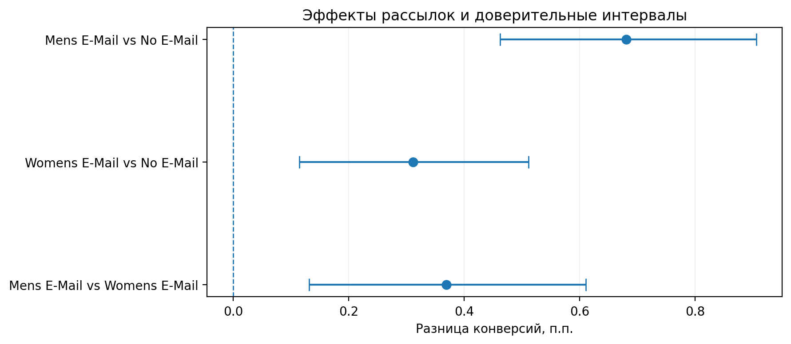
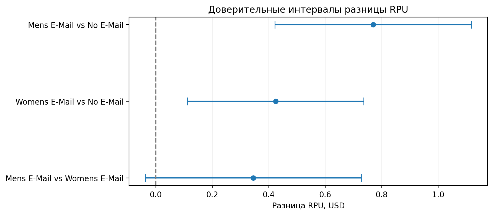

# A/B/n-тестирование email-рассылок

## Бизнес-задача

Интернет-магазин хочет повысить продажи с помощью email-маркетинга. Необходимо оценить эффективность двух вариантов рассылки и определить, какую стратегию стоит использовать.

В рамках проекта сравниваются три варианта: рассылка с мужскими товарами, рассылка с женскими товарами и отсутствие рассылки.

**Основная цель — увеличить конверсию в покупку.** Дополнительно оценивается влияние рассылок на выручку.

## Метрики

**Основная — Conversion Rate (CR)**

Доля клиентов, совершивших покупку в течение 14 дней после начала эксперимента.

**Дополнительная — Revenue Per User (RPU)**

Средняя выручка на одного клиента за тот же период. Рассчитывается по всем клиентам группы, включая тех, кто ничего не купил.

## Данные и дизайн эксперимента

Используется датасет **Hillstrom Email Marketing** — данные об эксперименте с email-рассылками интернет-магазина.

В эксперименте участвовали **64 000 клиентов**, случайным образом распределённых на три группы:

- **Mens E-Mail** — письмо с предложением мужских товаров.
- **Womens E-Mail** — письмо с предложением женских товаров.
- **No E-Mail** — контрольная группа, не получавшая письмо.

В данных содержатся история покупок клиентов, характеристики каналов взаимодействия с магазином, сведения о посещении сайта, факте покупки и сумме расходов за 14 дней.

Размеры групп близки. Проверка SRM не выявила статистически значимого отклонения от ожидаемого распределения 1:1:1.

[Источник данных](https://blog.minethatdata.com/2008/03/minethatdata-e-mail-analytics-and-data.html)

## Результаты

| Группа | Клиентов | CR | RPU |
|---|---:|---:|---:|
| Mens E-Mail | 21 307 | **1,25%** | **1,42 USD** |
| Womens E-Mail | 21 387 | 0,88% | 1,08 USD |
| No E-Mail | 21 306 | 0,57% | 0,65 USD |

Для проверки различий использовались Z-тест двух долей (CR) и t-критерий Уэлча (RPU). Для трёх попарных сравнений применялась поправка Холма, для совместных доверительных интервалов — поправка Бонферрони.

### Конверсия

Все три различия конверсий статистически значимы после поправки Холма. Мужская рассылка превосходит контроль на **0,68 п.п.**, женскую рассылку — на **0,37 п.п.**

### Выручка на клиента

Обе рассылки обеспечили статистически значимый прирост RPU относительно контроля. Прирост для мужской рассылки составил **0,77 USD на клиента**, для женской — **0,42 USD**.

Разница между двумя рассылками значима по методу Холма, однако одновременный доверительный интервал Бонферрони включает ноль.

### Распределение расходов

Средние расходы среди совершивших покупку относительно близки во всех группах. Различия в RPU в основном объясняются разницей в конверсии, а не размером покупки.

## Бизнес-вывод

**Рекомендуется использовать рассылку с мужскими товарами.**

По сравнению с отсутствием рассылки она показала:

- **+0,68 п.п. к конверсии** — относительный прирост около 119%.
- **+0,77 USD выручки на клиента** — относительный прирост около 118%.

Мужская рассылка также статистически значимо превосходит женскую по основной метрике — конверсии.

Результаты показывают, что для данной аудитории мужская рассылка является наиболее эффективной из рассмотренных стратегий. При этом **рост выручки не равен росту прибыли**: для оценки экономической эффективности необходимо учитывать стоимость отправки писем и другие связанные затраты.

## Инструменты

**Python:** pandas, NumPy, SciPy, statsmodels, matplotlib.

**Среда:** Google Colab.

Полный анализ, расчёты и проверки гипотез приведены в `hillstrom_ab_analysis.ipynb`.
